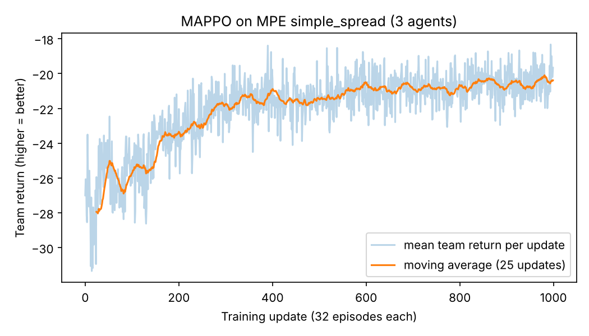

# MAPPO for Cooperative Navigation (MPE simple_spread)

Three agents learn to spread out and cover three landmarks without bumping into each other, using **MAPPO** (Multi-Agent Proximal Policy Optimization) written from scratch in PyTorch.

## The task

In `simple_spread` (from the [MPE2](https://mpe2.farama.org/) multi-agent environments):

- 3 agents and 3 landmarks are placed randomly in a 2D world.
- Each agent sees its own velocity and position, where the landmarks are, and where the other agents are (relative to itself).
- Each step, each agent picks one of 5 actions: stay, left, right, down, up.
- **Team reward:** the closer the landmarks are to being covered (sum of each landmark's distance to its nearest agent), the better. Collisions between agents are penalised.
- An episode lasts 25 steps.

The agents must **cooperate**: if two agents go to the same landmark, one landmark stays uncovered.

## Method: MAPPO with centralised training, decentralised execution (CTDE)

| Part | What it does |
| --- | --- |
| **Actor (policy)** | One small network shared by all agents (parameter sharing). Input: the agent's own observation + a one-hot agent ID. Output: probabilities over the 5 actions. At test time each agent uses only its own observation. |
| **Centralised critic** | A value network that sees the observations of all 3 agents. It is used only during training, to judge how good the team's situation is. |
| **PPO update** | Improves the policy using the clipped objective, so each update cannot change the policy too much. |
| **GAE** | Generalised Advantage Estimation, to estimate how much better an action was than expected. |

Why a central critic? In multi-agent learning, every agent's environment keeps changing because the other agents are also learning (**non-stationarity**). A critic that sees everyone gives a more stable learning signal.

## How to run

```bash
pip install -r requirements.txt
python mappo.py          # train (about 12-15 minutes on a laptop CPU)
python plot_results.py   # saves results/learning_curve.png
python evaluate.py       # compares trained agents with random and "stand still" baselines
```

Works on Google Colab too: upload the files, then run the same commands with `!` in front.

## Results

Trained for 1,000 updates (32 episodes each, 800,000 environment steps) on a laptop-class CPU in about 12 minutes. Evaluated over 100 new episodes:

| Policy | Mean team return (higher = better) |
| --- | --- |
| Random actions | -25.15 |
| Agents stand still | -23.67 |
| **Trained MAPPO** | **-19.73** |

The trained agents score about 22% better than random actions and about 17% better than standing still. The learning curve rises fastest in the first 400 updates and then improves slowly.



## Main settings

| Setting | Value |
| --- | --- |
| Agents / landmarks | 3 / 3 |
| Episode length | 25 steps |
| Episodes per update | 32 |
| Updates | 1000 |
| Learning rate | 0.001 (Adam) |
| PPO clip / epochs / minibatches | 0.2 / 10 / 2 |
| Discount (gamma) / GAE lambda | 0.99 / 0.95 |
| Entropy bonus | 0.01 |

## What I learned and next steps

- Multi-agent learning is noisy: with one episode per update the agents did not improve, so I collected 32 episodes per update.
- Parameter sharing with agent IDs makes training faster than separate networks per agent.
- Next: compare with independent PPO (no central critic), try more agents (N=5), and train longer.

## Reference

Yu, C., Velu, A., Vinitsky, E., Gao, J., Wang, Y., Bayen, A., and Wu, Y. (2022). *The Surprising Effectiveness of PPO in Cooperative Multi-Agent Games*. NeurIPS 2022 Datasets and Benchmarks.
